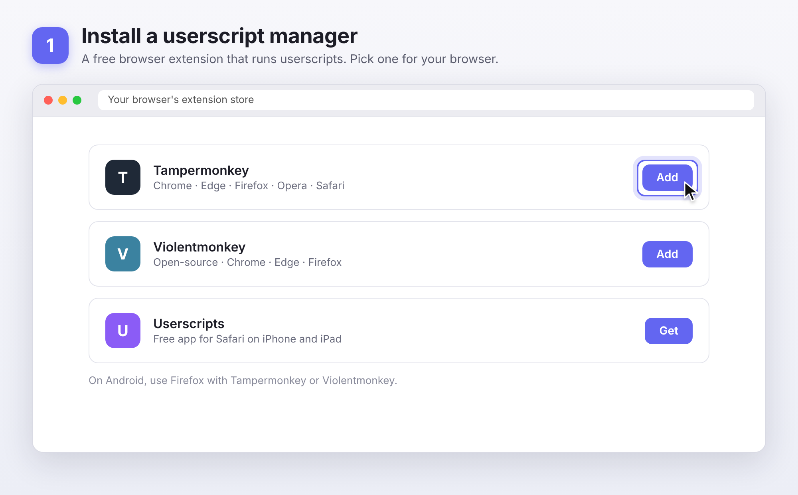
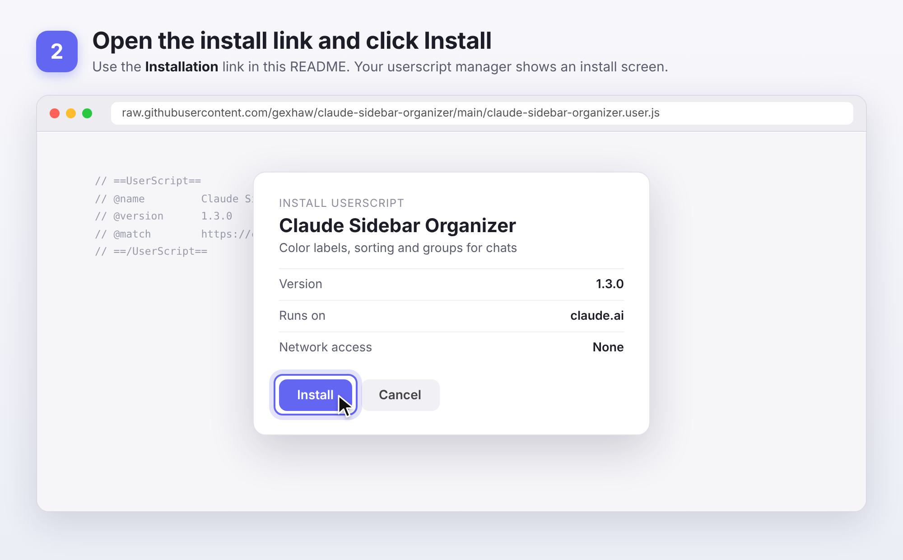
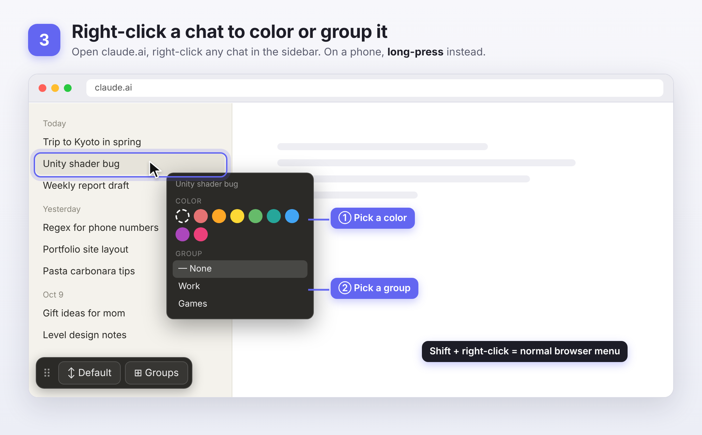
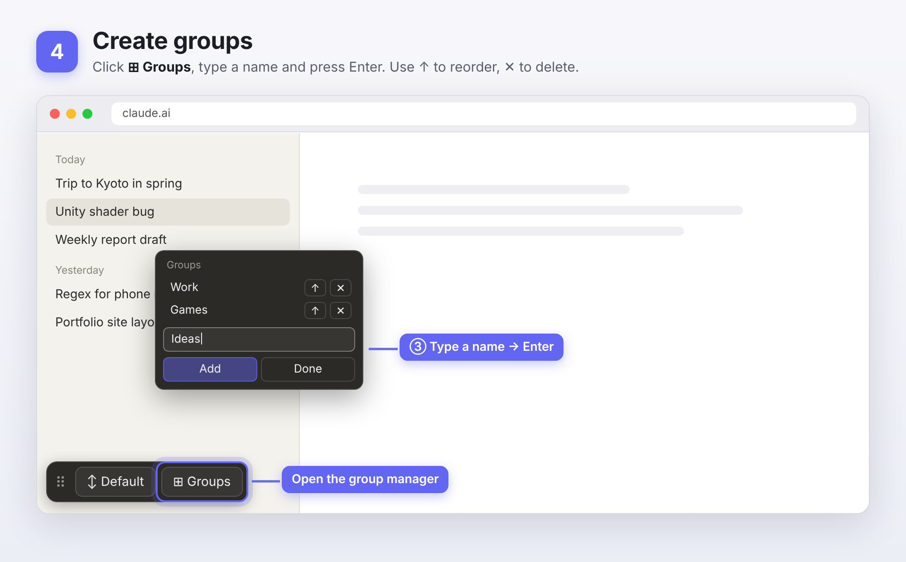
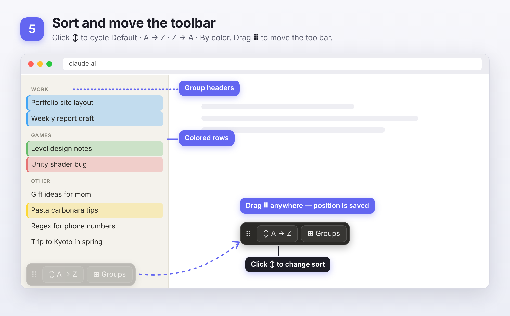

# Claude Sidebar Organizer

Userscript that adds color labels, sorting, and groups to the chat list in the Claude.ai sidebar.

 

## Features

- 🎨 **Color labels** — right-click any chat to tag it with one of 9 colors
- ↕️ **Sorting** — cycle between Default, A→Z, Z→A, and By color
- ⊞ **Groups** — create custom groups and assign chats to them; grouped chats render under their own header in the sidebar
- 💾 All data is stored locally in your browser (`localStorage`) — nothing is sent anywhere

## Step-by-step guide

## Requirements

You need a userscript manager extension installed in your browser:

- [Tampermonkey](https://www.tampermonkey.net/) — Chrome, Firefox, Edge, Safari, Opera
- [Violentmonkey](https://violentmonkey.github.io/) — open-source alternative
- [Greasemonkey](https://www.greasespot.net/) — Firefox only

### Mobile

The script works in mobile browsers that support userscripts:
- **Android** — Firefox with Tampermonkey or Violentmonkey
- **iOS / iPadOS** — Safari with Tampermonkey or the free [Userscripts](https://apps.apple.com/app/userscripts/id1463298887) app

On touch screens, **long-press** a chat instead of right-clicking. It does not work in the Claude mobile app — only in a browser at claude.ai.

## Installation

1. Install one of the userscript managers above.
2. Click this link to install the script directly:
   [claude-sidebar-organizer.user.js](https://raw.githubusercontent.com/gexhaw/claude-sidebar-organizer/main/claude-sidebar-organizer.user.js)
3. Your userscript manager will open an install prompt — confirm it.
4. Open or refresh [claude.ai](https://claude.ai).

If the link above doesn't trigger an install prompt automatically, open the userscript manager dashboard, choose "Create a new script," and paste in the contents of the `.user.js` file manually.

## Usage

The script adds a small toolbar in the bottom-left corner of the page with two buttons: **↕ Sort** and **⊞ Groups**. Drag it by the **⠿** handle to move it anywhere — the position is remembered.

### Coloring a chat
Right-click any chat in the sidebar → pick a color from the palette. The whole chat row is tinted with the color, with a solid stripe on its left edge. Click the dashed swatch to remove the color.

Need the browser's normal right-click menu (e.g. "Open in new tab")? Hold **Shift** while right-clicking.

### Sorting
Click the **↕ Default** button in the toolbar to cycle through sort modes:
- **Default** — Claude's original order
- **A → Z** / **Z → A** — alphabetical by chat title
- **By color** — groups chats by their assigned color

### Groups
Click **⊞ Groups** to open the group manager:
- Type a name and press **Enter** (or click **Add**) to create a group
- **↑** moves a group up — groups appear in the sidebar in this order
- **✕** deletes a group (its chats become ungrouped, not deleted)

To assign a chat to a group, right-click it and pick a group from the list under the color picker. Grouped chats appear under a header with the group name; everything else goes under **Other**. Groups work with every sort mode — the sort applies inside each group.

## How it works

The script never moves, inserts or removes elements that Claude's React app manages — doing so breaks the page. Instead it only sets `data-*` attributes and the CSS `order` property on existing sidebar items:
- **Sorting and groups** — the chat list becomes a flex column and each item gets a CSS `order`
- **Group headers** — drawn with a CSS `::before` pseudo-element on the first chat of each group
- **Colors** — a tinted background and inset stripe on the chat link

A throttled `MutationObserver` re-applies these when the chat list changes. Attribute changes don't trigger it, so there's no render loop, and changes inside the open conversation (streaming replies) are ignored.

All data — colors, group names, and group membership — lives in `localStorage` under the key `cso_data`, scoped to the claude.ai origin. Nothing is read from or sent to any server.

## Limitations

- This relies on Claude.ai's current DOM structure (chat links matching `a[href*="/chat/"]` inside the sidebar `<nav>`). If Anthropic changes their frontend significantly, the script may need updating — selectors live in `getLinks()` and `itemOf()`.
- Sorting applies to the chats currently loaded in the sidebar. Older chats appear once the sidebar loads them.
- Colors/groups are stored per-browser. They won't sync across devices.
- Works on the chat list only; doesn't currently apply to Projects.

## Contributing

Issues and PRs welcome. If claude.ai's markup changes and the script breaks, please open an issue with a screenshot of the sidebar's DOM structure (devtools → inspect element on a chat link) so the selectors can be updated.

## Disclaimer

This project is not affiliated with or endorsed by Anthropic. "Claude" is a trademark of Anthropic, PBC.

## License

MIT
